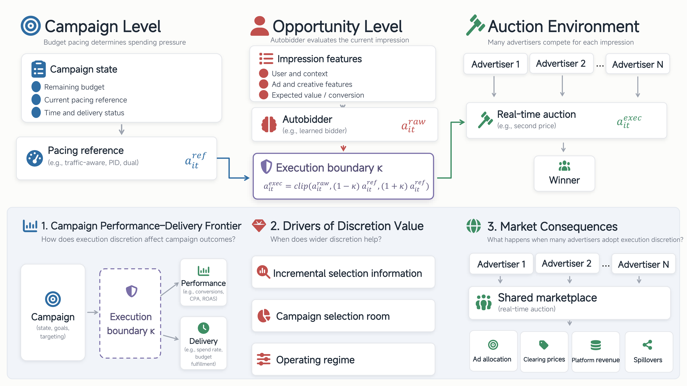

<div align="center">

# Execution Authority in Digital Advertising: Coordinating Autobidding and Campaign Control

**代码与数据发布**

[](#how-to-reproduce)
[](#datasets)
[](README.md)

</div>

---

**中文** · [**English**](README.md)

---

<p align="center">
  
  <br><em>Execution Boundary Framework</em>
</p>

---

## 目录

- [项目概览](#whats-inside)
- [autobidder](#bidders)
- [pacing 控制器](#controllers)
- [目录结构](#layout)
- [如何复现](#how-to-reproduce)
- [数据集与下载链接](#datasets)
- [License](#license)

---

<a id="whats-inside"></a>
## 项目概览

这篇论文研究数字广告中的**执行权（execution authority）**：受 pacing 控制的 autobidder，出价应该在多大程度上偏离 campaign control 的建议（bidder discretion，`κ`），以及两者如何协调。我们在五个学习型 autobidder、三类 pacing 控制器和三个数据集上评估执行边界（execution width `κ`）。

| 模块 | 内容 | 位置 |
| --- | --- | --- |
| **核心评估器** | 单广告主*微观*回放 + 48 广告主同步*宏观*市场模拟器 + 参考 pacing 策略 | `code/auctionnet/` |
| **autobidder** | CQL、IQL、DT、GAS、SemBid 的训练代码 | `code/bidders/` |
| **pacing 控制器** | traffic-aware、PID、dual（参考策略） | `code/auctionnet/micro/mandate_core_v2.py`、`code/common/reference_policies.py` |
| **数据集** | AuctionNet、T9Sim（带真值标注的模拟器）、iPinYou（真实竞价日志）的下载和解压脚本 | `data/` |
| **跨数据集分析** | iPinYou/T9Sim 聚合、campaign load 与 scenario calibration 分析、数据集规模核算 | `code/analysis/`、`plotting/data/load/`、`plotting/data/server_checked/` |
| **图表** | 每个图表的源 CSV 和画图代码 | `plotting/` |
| **冻结配置** | 实验网格（κ 宽度、采纳比例、随机种子） | `configs/` |

---

<a id="bidders"></a>
## autobidder

| autobidder | 类型 | 源码 |
| --- | --- | --- |
| **CQL** | Conservative Q-Learning（torch.jit） | `code/bidders/sembid_cpa/` |
| **IQL** | Implicit Q-Learning（torch.jit） | `code/bidders/sembid_cpa/` |
| **DT** | Decision Transformer（`state_dim=16`、`K=20`） | `code/bidders/sembid_cpa/` |
| **GAS** | Gradient-Ascent Strategy（DT 策略 + 重加权搜索 critic） | `code/bidders/gas/` |
| **SemBid** | 语言出价模型 | `code/bidders/sembid_cpa/` |

---

<a id="controllers"></a>
## pacing 控制器

traffic-aware、PID、dual 三种 pacing 用简洁、可审计的参考策略实现，代码在
`code/common/reference_policies.py` 和 `code/auctionnet/micro/mandate_core_v2.py`。
执行边界（execution boundary）会把 autobidder 的原生出价相对参考动作做一次裁剪：

```text
enforce_action(raw, ref, κ)  →  clip 到 [max{0, ref·(1−κ)}, ref·(1+κ)]   (relative_hard)
```

---

<a id="layout"></a>
## 目录结构

```text
├── code/
│   ├── auctionnet/          # 核心评估器（微观 + 宏观）+ 通用参考策略
│   ├── bidders/             # autobidder 的训练 + 推理源码
│   ├── t9sim/               # T9Sim 模拟器包 + 回放驱动
│   ├── ipinyou/             # iPinYou 预处理 + 日志回放驱动
│   └── analysis/            # 跨数据集聚合 + 数据集规模核算
├── configs/                 # 冻结实验网格（宏观/微观 κ 宽度 × 采纳比例 × 种子）
├── data/
│   ├── auctionnet/          # AuctionNet 下载 + 转换脚本
│   ├── t9sim/               # T9Sim（Zenodo）下载 + 提取脚本
│   └── ipinyou/             # iPinYou 下载 + 提取脚本
├── plotting/
│   ├── data/derived/        # 每张图/表的源 CSV（随仓库附带）
│   └── scripts/server_release/  # build_derived_data.py + 图表构建脚本
└── docs/                    # 复现指南 + 资产清单
```

---

<a id="how-to-reproduce"></a>
## 如何复现

仓库包含数据准备、训练和评估脚本，以及论文图表对应的源表。

需要准备：三个公开数据集（下载链接见下文）和训练好的 bidder checkpoint。

1. 用 `data/<dataset>/` 下的脚本下载并解压数据集。
2. 用 `code/bidders/` 下的入口训练五个 bidder。
3. 运行 `code/auctionnet/`、`code/t9sim/`、`code/ipinyou/` 下的评估器。
4. 运行 `build_derived_data.py`，把评估产出转成 `plotting/data/derived/` 下的源表；
   每个图表对应的源表见 `FIGURE_TABLE_CROSSWALK.md`。
5. 从源表重建图表：

```bash
pip install pandas numpy matplotlib
cd plotting/scripts/server_release
python build_all_figures.py      # → plotting/figures/ec/*.png
cd ../../.. && python plotting/scripts/rebuild_main_figures.py   # → 主图 2–7
```

---

<a id="datasets"></a>
## 数据集与下载链接

| 数据集 | 说明 | 下载 | 许可 / 条款 |
| --- | --- | --- | --- |
| **AuctionNet** | Alimama 自动出价赛道（第 7–8 期、轨迹数据） | [Alimama OSS](https://alimama-bidding-competition.oss-cn-beijing.aliyuncs.com/share/)——8 个 ZIP（第 7–8 期、轨迹数据和 `final/` 版本；完整列表见 `docs/REPRODUCTION.md` §2.1） | Alimama 竞赛条款 |
| **T9Sim** | 带真值标注的 RTB 模拟器（10 × 1000 万曝光种子） | [Zenodo 21533031](https://zenodo.org/records/21533031)（DOI 10.5281/zenodo.21533031） | CC-BY-4.0 |
| **iPinYou** | 真实日志 RTB 广告活动数据（1950 万条：模型拟合 1231.9 万 + 校准 307.6 万 + 测试 410.1 万） | [主数据集](https://www.dropbox.com/scl/fi/dlam6yqswcwu4x0dnooig/ipinyou.contest.dataset.7z?rlkey=h7q2ey4f7u8n0w7y8euo3zx20&dl=1) · [season 2](https://ndownloader.figshare.com/files/10082688) | iPinYou 竞赛条款 |

每个 `data/<dataset>/` 目录包含对应的下载、校验、提取脚本。

---

<a id="license"></a>
## License

The evaluation/analysis code in `code/` is released for academic reproduction.
Third-party components carry their own licenses: T9Sim (`code/t9sim/T9-simulator/`,
see its `LICENSE` / `LICENSE-DATA`), GAS (`code/bidders/gas/`), and the
iPinYou/AuctionNet datasets under their respective terms. See
`docs/REPRODUCTION.md` for per-component notes.
